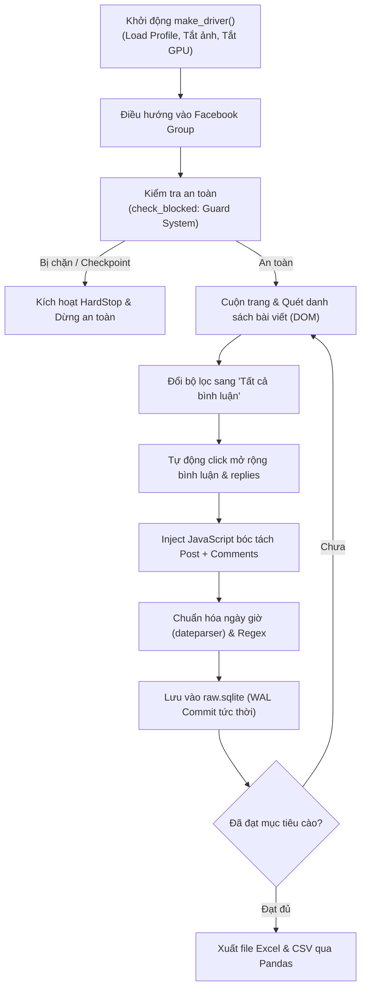

# BÁO CÁO CÔNG CỤ VÀ KỸ THUẬT THU THẬP DỮ LIỆU (CRAWLING TOOLS)
**Dự án:** Phân tích cảm xúc dữ liệu sinh viên UIT (UIT Confession Sentiment Analysis)

---

## 1. Tổng quan bài toán thu thập dữ liệu

* **Đối tượng thu thập:** Nhóm Facebook UIT Confessions (bài viết và toàn bộ bình luận, phản hồi con).
* **Đặc thù kỹ thuật:**
  * Facebook là ứng dụng Single Page Application (SPA) xây dựng trên nền tảng React.
  * Toàn bộ DOM được render động qua JavaScript với cơ chế cuộn vô tận (Infinite Scroll) và lazy loading.
  * Các nút tương tác quan trọng như bộ lọc bình luận (*"Tất cả bình luận"*), nút mở rộng (*"Xem thêm bình luận"*, *"Xem thêm câu trả lời"*) đòi hỏi giả lập hành vi người dùng thật.
  * Facebook áp dụng thuật toán kiểm soát bot, giới hạn tần suất (rate limiting) và cơ chế khóa tạm thời (checkpoint/captcha).

---

## 2. Danh mục công cụ và giải thích chi tiết

### 2.1. Selenium WebDriver & Google Chrome
* **Tệp tin triển khai:** `src/uitconf/scraper/driver.py`
* **Vai trò:** Công cụ tự động hóa trình duyệt chính.
* **Chi tiết kỹ thuật:**
  * Khởi tạo và điều khiển trình duyệt Google Chrome thông qua `selenium.webdriver.Chrome`.
  * **Quản lý Profile người dùng (`--user-data-dir`):** Duy trì thư mục `browser_profile` riêng biệt để lưu cookie và phiên đăng nhập của tài khoản Facebook. Nhờ vậy, quy trình không cần thực hiện đăng nhập lại mỗi lần chạy script, giảm thiểu tối đa rủi ro bị nghi ngờ tài khoản bất thường.
  * **Tối ưu tài nguyên:**
    * `--blink-settings=imagesEnabled=false`: Tắt hoàn toàn việc tải ảnh, giảm băng thông mạng và tăng tốc độ cuộn tải trang.
    * `--disable-gpu`, `--disable-notifications`: Tắt thông báo đẩy của hệ điều hành và vô hiệu hóa GPU để đảm bảo sự ổn định khi chạy dài giờ trên Windows.

### 2.2. Kỹ thuật JavaScript DOM Injection (`driver.execute_script`)
* **Tệp tin triển khai:** `crawl_full_dataset.py`, `scripts/crawl_comments_june_july.py`
* **Vai trò:** Trích xuất dữ liệu trực tiếp trong không gian bộ nhớ của trình duyệt.
* **Chi tiết kỹ thuật:**
  * Khác với cách tiếp cận thông thường dùng Selenium gọi từng lệnh `.find_elements()` (thường rất chậm và dễ gây lỗi `StaleElementReferenceException` khi Facebook re-render giao diện), hệ thống bơm các đoạn script JavaScript trực tiếp vào DOM.
  * JavaScript duyệt qua cấu trúc các thẻ `div[role='article']`, phân tách chính xác:
    * Tiêu đề, văn bản bài viết, tên tác giả (hoặc tác giả ẩn danh).
    * Lượt cảm xúc (reactions), lượt chia sẻ (shares), số lượng bình luận.
    * Thời gian đăng tải và liên kết cố định (permalink).
    * Cây bình luận đa cấp (bình luận cha và các phản hồi con - replies).

### 2.3. Hệ quản trị cơ sở dữ liệu SQLite3 (WAL Mode)
* **Tệp tin triển khai:** `src/uitconf/db.py`, tệp CSDL: `data/raw/raw.sqlite`
* **Vai trò:** Lưu trữ dữ liệu thô cục bộ, đảm bảo tính bền vững (Durability).
* **Chi tiết kỹ thuật:**
  * Kích hoạt chế độ **WAL (Write-Ahead Logging)** (`PRAGMA journal_mode=WAL`) giúp việc ghi dữ liệu diễn ra liên tục mà không gây khóa (lock) cơ sở dữ liệu.
  * Thực hiện **Atomic Commit** sau khi hoàn tất mỗi bài viết. Nếu gặp sự cố mất điện, đứt cáp mạng hoặc tiến trình bị ngắt đột ngột, toàn bộ bài viết và bình luận đã thu thập trước đó đều được bảo toàn nguyên vẹn.

### 2.4. Hệ thống an toàn & Chống khóa tài khoản (Guard & Jitter System)
* **Tệp tin triển khai:** `src/uitconf/scraper/guard.py`
* **Vai trò:** Giám sát trạng thái hoạt động và phòng ngừa rủi ro khóa tài khoản.
* **Chi tiết kỹ thuật:**
  * **Jitter & Random Delays (`time`, `random`):** Tạo thời gian chờ ngẫu nhiên giữa các hành động cuộn trang (scroll) và nhấp chuột (click) để mô phỏng nhịp độ đọc tin của con người.
  * **Cơ chế Dừng khẩn cấp (`HardStop`):**
    * Quét URL để phát hiện các dấu hiệu: `checkpoint`, `/login`, `captcha`, `two_step_verification`.
    * Quét các cửa sổ thông báo (modal/dialog) chứa thông điệp cảnh báo như: *"xác nhận danh tính"*, *"tài khoản bị hạn chế"*, *"bạn tạm thời không thể"*, *"unusual activity"*.
    * Khi phát hiện, tiến trình lập tức dừng an toàn thay vì cố gắng tương tác, bảo vệ tài khoản khỏi checkpoint vĩnh viễn.

### 2.5. Xử lý thời gian và cấu hình: `dateparser` & `pyyaml`
* **Tệp tin triển khai:** `src/uitconf/scraper/parse.py`, `src/uitconf/config.py`
* **Vai trò:** Chuẩn hóa thời gian và quản trị tham số hệ thống.
* **Chi tiết kỹ thuật:**
  * **`dateparser`:** Chuyển đổi các định dạng ngày giờ tương đối và tuyệt đối trong tiếng Việt của Facebook (ví dụ: *"Vừa xong"*, *"5 giờ trước"*, *"Hôm qua lúc 18:30"*, *"15 Tháng 5, 2024"*) thành kiểu dữ liệu `datetime` chuẩn ISO để phân tích chuỗi thời gian.
  * **`pyyaml`:** Quản lý cấu hình tập trung từ tệp `config.yaml` (URL nhóm mục tiêu, ngôn ngữ giao diện, số bài mục tiêu, thư mục profile).

### 2.6. Thư viện phân tích & Xuất dữ liệu: `pandas`
* **Tệp tin triển khai:** `scripts/export_excel_dataset.py`
* **Vai trò:** Trích xuất, tổng hợp và định dạng tập dữ liệu bàn giao.
* **Chi tiết kỹ thuật:**
  * Truy vấn bảng `posts` và `comments` từ SQLite sang DataFrame.
  * Xuất bản tập dữ liệu dưới hai định dạng tiêu chuẩn:
    * **CSV:** `1877_bai_viet_posts.csv` (chuẩn: `dataset_uit_posts.csv`), `7009_binh_luan_comments.csv` (chuẩn: `dataset_uit_comments.csv`)
    * **Excel:** `dataset_uit_posts_and_comments.xlsx` (chứa 2 sheets `Bai_Viet_1877` và `Binh_Luan_7009`)

### 2.7. Hệ thống giám sát: Python `logging` Module
* **Tệp tin triển khai:** `crawl_full_dataset.py`, lưu tại thư mục `logs/crawl_full_dataset.log`
* **Vai trò:** Ghi nhận nhật ký vận hành thời gian thực.
* **Chi tiết kỹ thuật:**
  * Ghi lại chi tiết từng lượt bài viết: ID, số comment bóc tách được, thời gian xử lý và các cảnh báo bất thường.
  * Cho phép người vận hành theo dõi tiến độ khi chạy nền hoặc chạy tự động qua đêm.

---

## 3. Sơ đồ quy trình thu thập dữ liệu (Workflow)

---

## 4. Tóm tắt kết quả thu thập thực tế

| Loại dữ liệu | Số lượng thực tế trong tệp | Chi tiết trong CSDL (`raw.sqlite`) | Tệp xuất bản tương ứng |
|---|---|---|---|
| **Bài viết đầy đủ bình luận** (`comments_full`) | **1.877** bài | 1.877 bài hoàn tất cào bình luận *(trên tổng số 4.276 bài trong DB)* | [`1877_bai_viet_posts.csv`](file:///d:/uit-confession-sentiment/1877_bai_viet_posts.csv) [`dataset_uit_posts.csv`](file:///d:/uit-confession-sentiment/dataset_uit_posts.csv) |
| **Bình luận & Phản hồi** (Comments & Replies) | **7.009** bình luận | 7.009 bình luận và phản hồi con liên kết | [`7009_binh_luan_comments.csv`](file:///d:/uit-confession-sentiment/7009_binh_luan_comments.csv) [`dataset_uit_comments.csv`](file:///d:/uit-confession-sentiment/dataset_uit_comments.csv) |
| **Tập dữ liệu Excel tổng hợp** | Sheet `Bai_Viet_1877` Sheet `Binh_Luan_7009` | 1.877 bài viết + 7.009 bình luận | [`dataset_uit_posts_and_comments.xlsx`](file:///d:/uit-confession-sentiment/dataset_uit_posts_and_comments.xlsx) |

